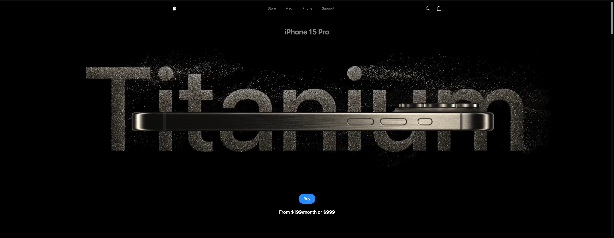
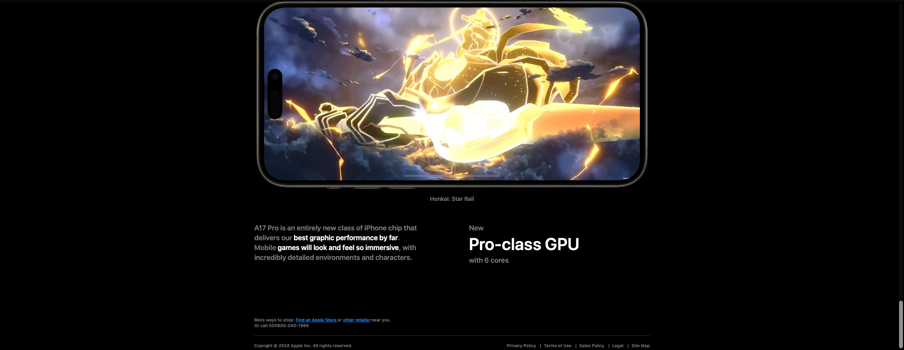
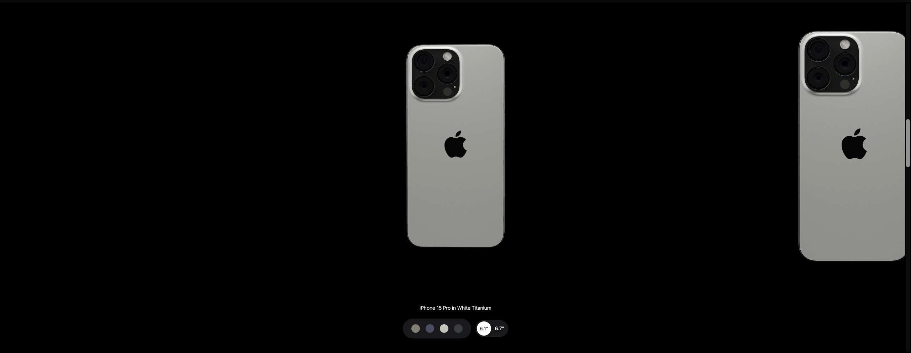
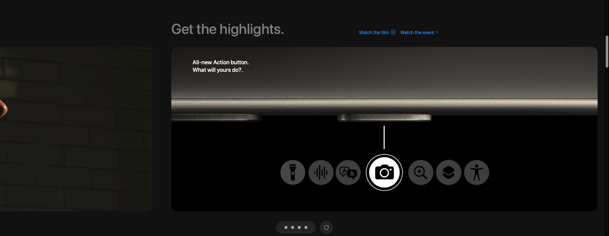
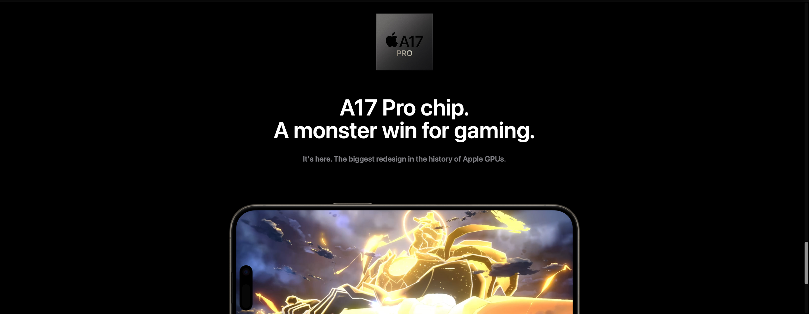

#  iPhone 15 Pro — Interactive Website

<p align="center">
  <strong>A cinematic, interactive recreation of Apple's iPhone 15 Pro product-page experience.</strong>
</p>

<p align="center">
  Built with React, Three.js, React Three Fiber, GSAP, and Tailwind CSS.
</p>

<p align="center">
  
  
  
  
  
</p>

---

## Overview

This project recreates the visual experience of Apple's iPhone 15 Pro product page, combining immersive product visuals, scroll-triggered animations, video storytelling, and interactive 3D rendering.

The focus is on exploring how modern frontend technologies can work together to create a polished, product-focused web experience.

**This is an independent frontend recreation for educational and portfolio purposes. It is not an official Apple website and is not affiliated with Apple Inc.**

## Preview

<p align="center">
  
</p>

<p align="center"><sub>01 / Hero — Cinematic product introduction</sub></p>

<table>
  <tr>
    <td width="50%" valign="top">
      
      <p align="center"><strong>02 / Product Highlights</strong></p>
      <p>Video-led storytelling with animated transitions.</p>
    </td>
    <td width="50%" valign="top">
      
      <p align="center"><strong>03 / Interactive 3D Model</strong></p>
      <p>Explore different finishes and device sizes.</p>
    </td>
  </tr>
  <tr>
    <td width="50%" valign="top">
      
      <p align="center"><strong>04 / Feature Showcase</strong></p>
      <p>Video, imagery, and animated content sections.</p>
    </td>
    <td width="50%" valign="top">
      
      <p align="center"><strong>05 / A17 Pro Experience</strong></p>
      <p>A dedicated section highlighting chip and gaming visuals.</p>
    </td>
  </tr>
</table>

---

## Features

### 🎬 Cinematic Hero Section
- Product-focused landing section with an animated introduction.
- Separate hero video sources for smaller and larger screens.
- Minimal navigation and prominent call-to-action styling.

### 🎞️ Animated Product Highlights
- Video carousel featuring iPhone 15 Pro highlights.
- GSAP-powered transitions and scroll-triggered playback behavior.
- Animated progress indicators and playback controls.

### 📱 Interactive 3D iPhone
- Real-time 3D rendering using Three.js and React Three Fiber.
- Multiple titanium-inspired finishes.
- Selectable device sizes.
- Camera controls configured for interactive rotation without zooming or panning.
- Loading fallback while the 3D model is being prepared.

### ✨ Feature Storytelling
- Scroll-triggered transitions and reveal animations.
- Video and image-based product sections.
- Dedicated A17 Pro and gaming-related content.
- Dark, product-focused visual styling.

### 📐 Responsive Layout
- Tailwind CSS utility-based styling.
- Responsive layouts and spacing.
- A separate hero video source for mobile-sized screens.

---

## Tech Stack

| Technology | Purpose |
|---|---|
| React 18 | Component-based UI |
| Vite 5 | Development server and production build |
| Tailwind CSS 3 | Responsive styling and design utilities |
| Three.js | 3D rendering |
| React Three Fiber | React integration for Three.js |
| React Three Drei | 3D helpers, camera controls, and model utilities |
| GSAP | Animation timelines and transitions |
| `@gsap/react` | GSAP integration with React components |
| ScrollTrigger | Scroll-based animation behavior |
| Sentry | Error monitoring and performance instrumentation |

---

## Project Structure

```text
Apple-Website/
├── public/
│   ├── assets/
│   │   ├── images/
│   │   ├── videos/
│   │   └── models/
│   └── ...
├── src/
│   ├── components/
│   │   ├── Features.jsx
│   │   ├── Footer.jsx
│   │   ├── Hero.jsx
│   │   ├── Highlights.jsx
│   │   ├── HowItWorks.jsx
│   │   ├── IPhone.jsx
│   │   ├── Lights.jsx
│   │   ├── Loader.jsx
│   │   ├── Model.jsx
│   │   ├── ModelView.jsx
│   │   ├── Navbar.jsx
│   │   └── VideoCarousel.jsx
│   ├── constants/
│   │   └── index.js
│   ├── utils/
│   │   ├── animations.js
│   │   └── index.js
│   ├── App.jsx
│   ├── index.css
│   └── main.jsx
├── docs/
│   └── images/
│       ├── hero.png
│       ├── highlights.png
│       ├── 3d-model.png
│       ├── features.png
│       └── chip.png
├── index.html
├── package.json
├── package-lock.json
├── postcss.config.js
├── tailwind.config.js
├── vite.config.js
└── README.md
```

*The `docs/images/` directory above is for the README screenshots; create it and add the images if it does not already exist. The `public/assets/` listing is abbreviated.*

### Architecture at a Glance

- **`App.jsx`** — Composes the main page sections.
- **`components/`** — Contains the UI sections, 3D model components, and video carousel.
- **`constants/`** — Stores navigation labels, highlight content, model finishes, and related configuration.
- **`utils/animations.js`** — Provides shared GSAP animation helpers.
- **`utils/index.js`** — Exposes paths for image, video, and other visual assets.
- **`index.css`** — Defines Tailwind directives and shared layout utilities.
- **`vite.config.js`** — Configures Vite, the React plugin, and Sentry's build plugin.

---

## Getting Started

Run the project locally using the following steps.

### Prerequisites

Install **Node.js and npm** on your machine.

### 1. Clone the Repository

```bash
git clone https://github.com/Krishnendu1910/Apple-Website.git
```

### 2. Open the Project Directory

```bash
cd Apple-Website
```

### 3. Install Dependencies

```bash
npm install
```

### 4. Start the Development Server

```bash
npm run dev
```

Open the local URL printed in your terminal by Vite, usually:

```text
http://localhost:5173
```

### 5. Build for Production

```bash
npm run build
```

The production build is generated in the `dist/` directory.

### 6. Preview the Production Build

```bash
npm run preview
```

### Optional: Run ESLint

```bash
npm run lint
```

The lint script is configured in `package.json`. Its current status has not been verified.

---

## Implementation Highlights

### 1. 3D Rendering

The 3D product experience uses React Three Fiber to integrate Three.js into the React component tree. React Three Drei supplies helpers for model loading, camera setup, and interaction controls.

### 2. Animation System

GSAP handles interface transitions and animation sequences, while ScrollTrigger supports scroll-based behavior. Shared animation helpers are maintained in the utilities directory.

### 3. Data-Driven Product Selection

Product finish options, colors, images, and supported device sizes are represented in the constants module and consumed by the model-selection components.

### 4. Asset-Based Storytelling

Product videos, images, icons, and the 3D model are referenced through the project's utility module and public assets.

---

## Learning Outcomes

This project provides practical experience with:

- Building reusable React components.
- Integrating a 3D rendering library into a React application.
- Managing interactive product views and component state.
- Creating scroll-triggered animations and video-driven interfaces.
- Organizing visual assets and shared animation utilities.
- Applying responsive styling to a product-focused layout.

---

## Known Scope and Limitations

- This is a frontend recreation, not Apple's official product website.
- The displayed purchase call-to-action is part of the recreated interface; a real purchasing or checkout system is not implemented in the reviewed code.
- The project depends on its local image, video, and 3D model assets being available.
- The repository has not been independently tested across every browser, device, or screen size.

---

## Credits and Attribution

This project is inspired by Apple's official iPhone 15 Pro product-page design.

The 3D iPhone model component credits the following asset:

- **Creator:** Polyman
- **Source:** [Apple iPhone 15 Pro Max Black — Sketchfab](https://sketchfab.com/3d-models/apple-iphone-15-pro-max-black-df17520841214c1792fb8a44c6783ee7)
- **License:** [Creative Commons Attribution 4.0 International (CC BY 4.0)](https://creativecommons.org/licenses/by/4.0/)

Apple, iPhone, and related product marks belong to their respective owners. This project is an independent educational recreation.

---

## Author

**Krishnendu Sarkar**

- GitHub: [@Krishnendu1910](https://github.com/Krishnendu1910)
- LinkedIn: [Krishnendu Sarkar](https://www.linkedin.com/in/krishnendu-sarkar-087bba257/)

---

<p align="center">
  <strong>Built to explore the intersection of frontend engineering, animation, and interactive 3D experiences.</strong>
</p>
